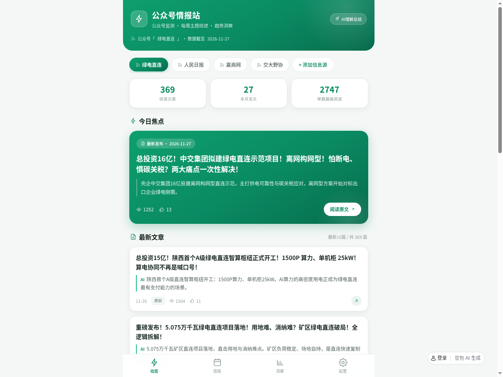
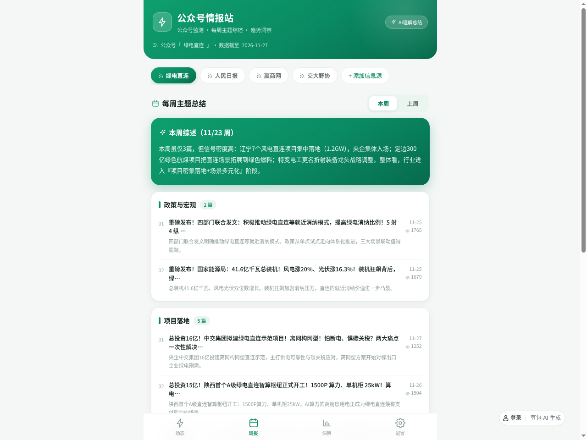
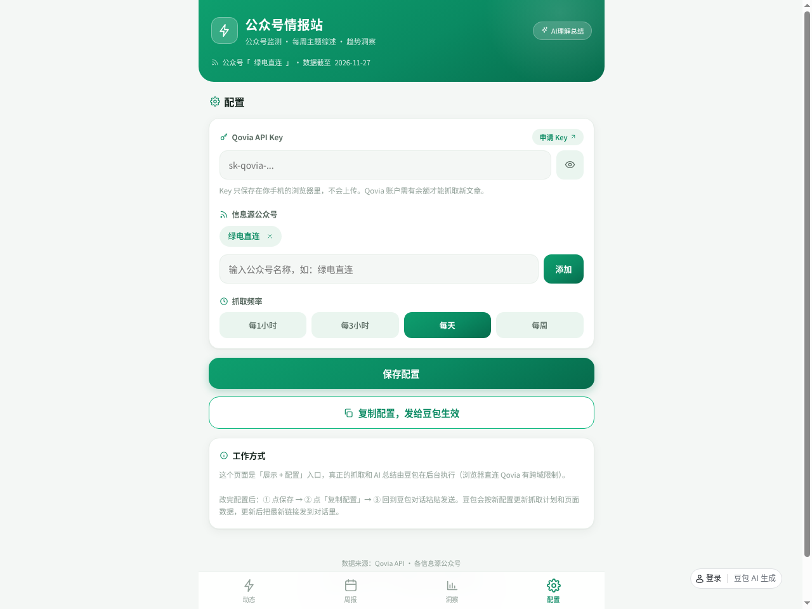

# wechat-radar · 公众号情报站

给 AI Agent（豆包 / WorkBuddy 等）用的开源能力包：**自动抓取公众号最新文章 → AI 写总结 → 生成手机可打开的情报页面 → 每天自动更新**。

你只需要：一个 Qovia API Key + 想看的公众号名字，剩下的交给 Agent。

## 页面长什么样

| 动态（今日焦点 + 最新10篇 AI 点评） | 周报（本周主题总结） | 配置（Key 与信息源管理） |
|---|---|---|
|  |  |  |

- 顶部信息源筛选 Tab，多个公众号一键切换
- 固定网址，每天覆盖更新内容，收藏一次永久使用
- 手机端优化，可「添加到主屏幕」当 App 用

---

## 第一步：申请 Qovia API Key（约 2 分钟）

1. 打开 **https://www.qovia.ai/zh/wechat-api/** ，注册账号
2. 在控制台创建 API Key，形如 `sk-qovia-xxxxxxxx`
3. 新账号有免费试用额度；之后按次计费（约 $0.005/次，充 $5 能用很久）
4. 额度与余额查询：**https://www.qovia.ai/zh/account/**

> 文章搜索/抓取消耗额度；空结果与账户查询不计费。

## 第二步：把这段话贴给豆包 / WorkBuddy

复制下面的提示词，**把 Key 和公众号名换成你自己的**，直接发给你常用的 Agent：

```text
帮我搭建「公众号情报站」，参考开源能力包 https://github.com/rannnnyihan/wechat-radar
（内含抓取脚本 scripts/ 与页面模板 assets/，请先阅读其 SKILL.md 和 README.md）。

我的配置：
- Qovia API Key：sk-qovia-换成你的Key
- 信息源（可多个）：人民日报、赢商网、绿电直连
- 更新频率：每天一次，早上 06:45

要求：
1. 抓取：优先用 POST https://api.qovia.ai/v1/search，JSON 参数
   {"query":"该号常见主题词","platforms":["wechat"],"author":"公众号精确名","limit":20,"page":1}
   用多个关键词轮询补全（如人民日报用 中国/新闻/社会，赢商网用 商业/购物中心/零售）；
   只保留 author.name 与信息源名精确一致的文章，按 URL 去重。
   若某号有 gh_ 完整档案（如绿电直连 mp_id=gh_0ad57a1aa80b），
   也可用 GET /v1/raw/wechat/articles?mp_id=xxx 分页抓取（含阅读数）。
2. 总结：为最新 10 篇写 AI 一句话点评（结合标题与 text 正文片段），
   并生成本周主题总结与 2-4 个主题分组。
3. 页面：生成手机端单文件 HTML（动态/周报/洞察/配置四页 + 顶部信息源筛选），
   发布为可访问的固定链接，之后每次覆盖更新同一链接。
4. 自动化：创建每天 06:45 的定时任务：增量抓新文章 → 更新 AI 总结 →
   重新生成页面 → 覆盖发布，有更新就通知我；额度不足(402)时提醒我充值。
```

> 安全提示：API Key 只发给你信任的 Agent 对话，不要贴到公开群聊或评论区。

## 第三步：告诉 Agent 你想看什么

- **加/换公众号**：直接说「把 xx 加进信息源」即可。Agent 会用作者名精确匹配抓取，自动排除矩阵号/地方站
- **改频率**：说「改成每 2 小时 / 每周一」等，Agent 会调整定时任务
- **query 关键词怎么选**：用该号标题里的高频词。例如招投标类号用「中标、招标」，户外社团号用「户外、徒步、登山」

---

## 进阶：本地跑脚本（开发者）

```bash
git clone https://github.com/rannnnyihan/wechat-radar.git
cd wechat-radar
cp config.example.json config.json   # 填入 qovia_key、sources、search_method
python3 scripts/fetch_wechat.py      # 抓取（增量去重）
python3 scripts/gen_page.py          # 生成 output/公众号情报站.html
```

`config.json` 示例：

```json
{
  "qovia_key": "sk-qovia-你的Key",
  "sources": ["绿电直连", "人民日报", "赢商网"],
  "search_method": {
    "人民日报": {"query": ["中国", "新闻", "社会"], "author": "人民日报"},
    "赢商网": {"query": ["商业", "购物中心", "零售"], "author": "赢商网"}
  },
  "fetch": {"max_pages": 30, "page_size": 20}
}

```

定时更新可用系统 cron，例如每天 06:45：

```cron
45 6 * * * cd /path/to/wechat-radar && python3 scripts/fetch_wechat.py && python3 scripts/gen_page.py
```

生成的 HTML 为纯静态单文件，可部署到任意静态托管（GitHub Pages / Vercel / 对象存储），无需后端代理。

## 抓取路径怎么选

| 公众号情况 | 推荐路径 |
|---|---|
| 有 gh_ 完整档案（如绿电直连） | `GET /v1/raw/wechat/articles?mp_id=gh_xxx`（含阅读数标签） |
| 大多数公众号（人民日报/赢商网/交大野协…） | `POST /v1/search` + author 过滤（带正文摘要，无需 gh_ ID） |
| 索引未收录的号 | 提供文章链接，用单篇接口 `article_metrics` / `article_content_v3` 实时抓取 |

## FAQ

- **402**：额度耗尽，去 https://www.qovia.ai/zh/account/ 充值后重试
- **upstream_rejected / 502**：Qovia 上游接口临时故障，稍后重试；不影响 `/v1/search` 主路径
- **某号一直搜不到**：该号未被索引收录，发一篇文章链接给 Agent 走单篇接口
- **浏览器直连 Qovia 报 CORS**：正常，Qovia 不允许浏览器跨域调用；请由 Agent 服务端或本地脚本发起请求，无需自建代理

---

by [@rannnnyihan](https://github.com/rannnnyihan) · 基于 [Qovia](https://www.qovia.ai/zh/wechat-api/) 数据能力
